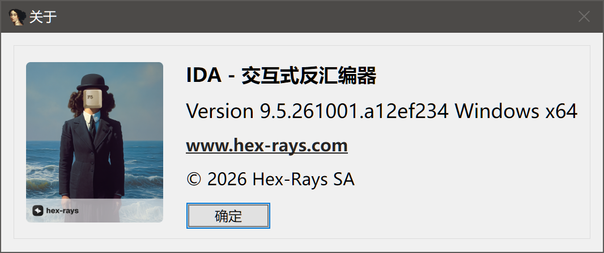
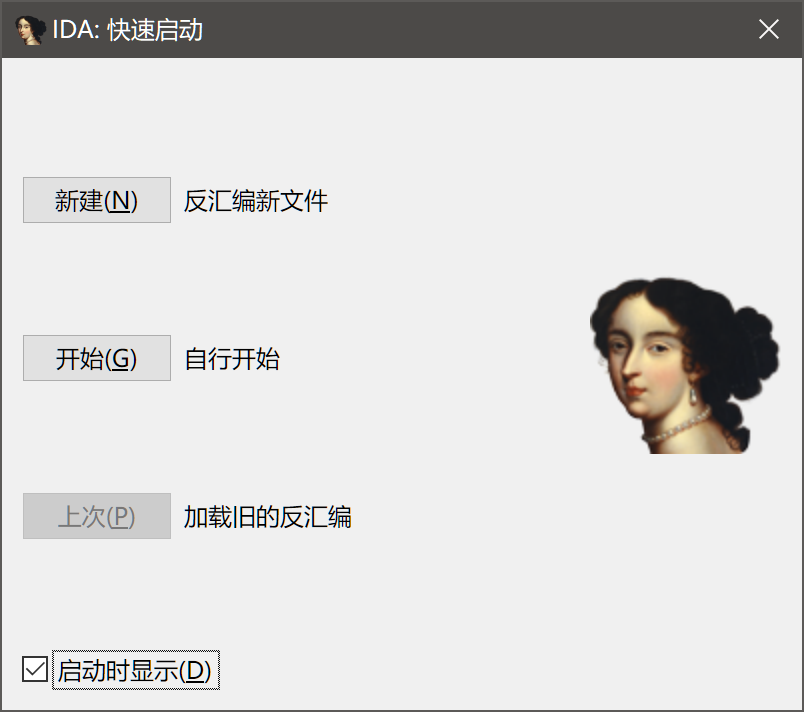
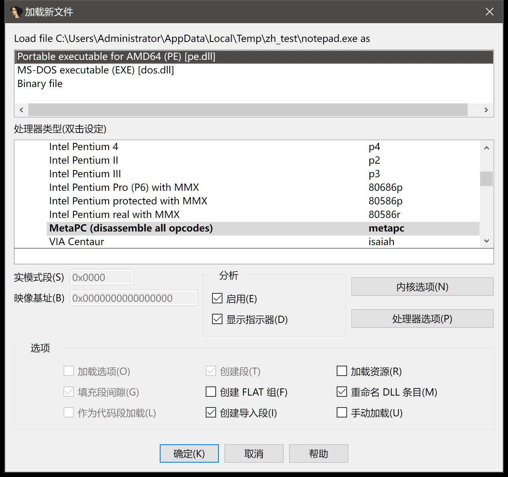
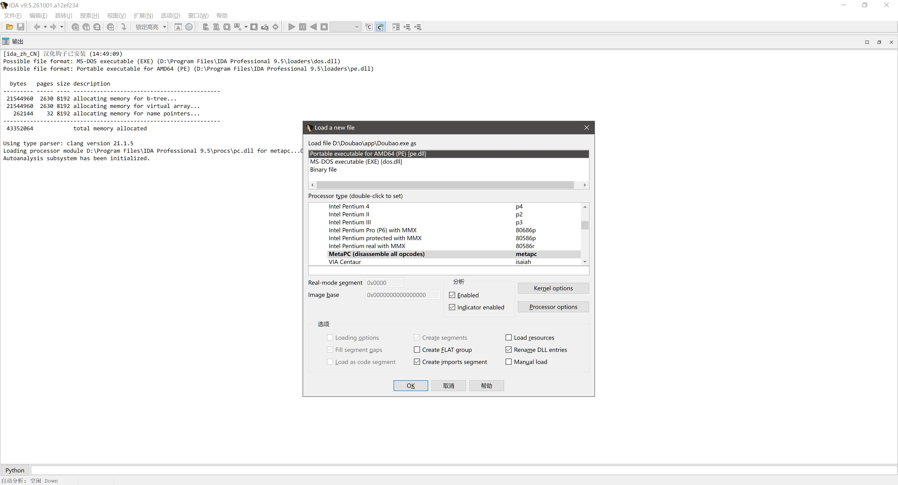
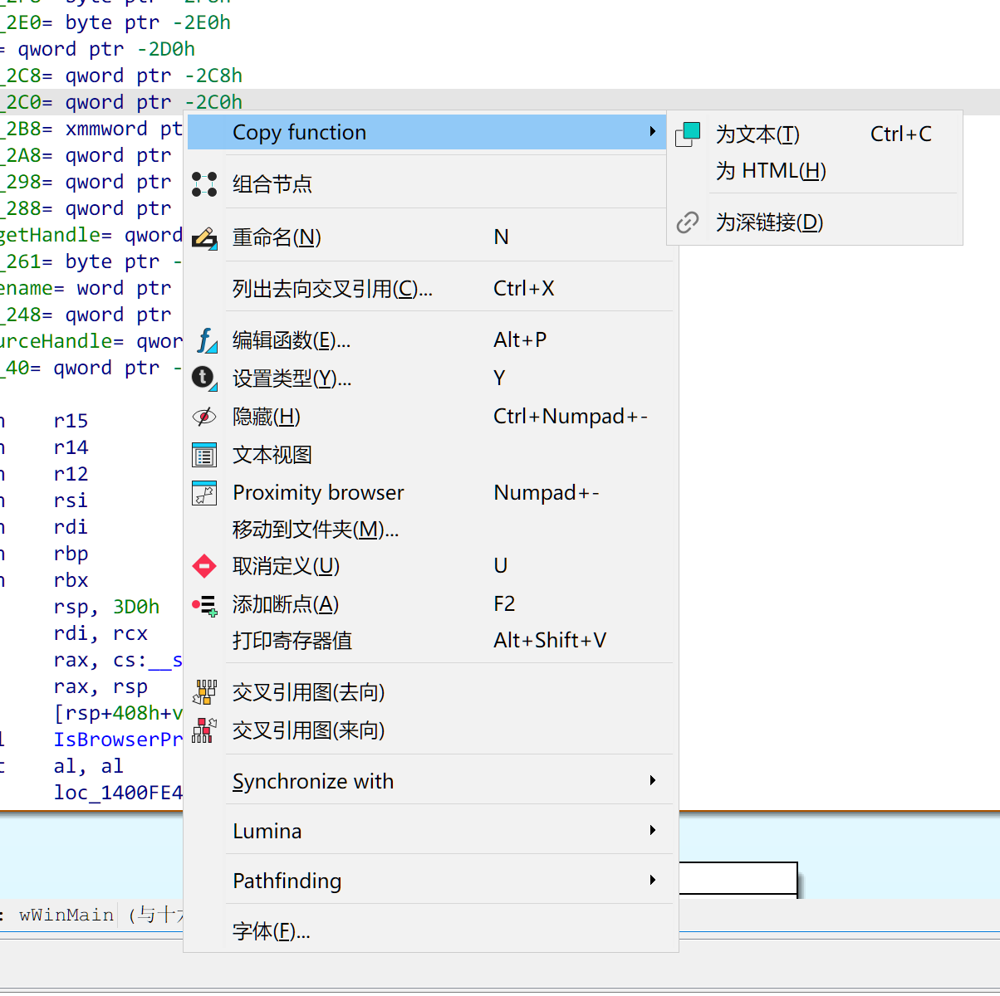
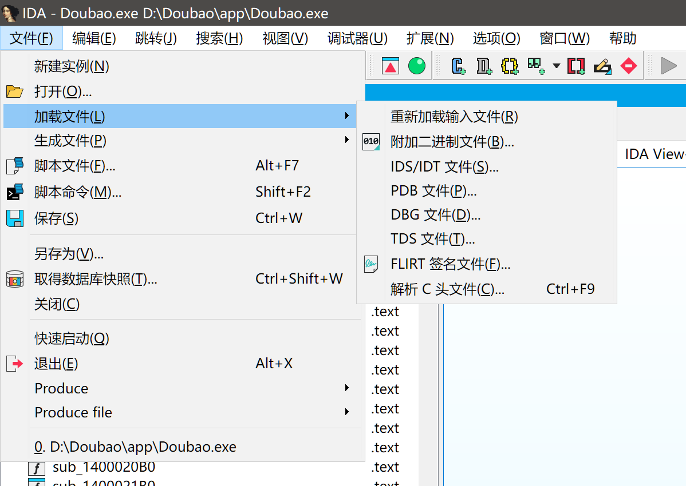

# IDA Pro 9.5 界面汉化补丁(ida_zh_CN)

以 IDAPython 插件形式运行,汉化 IDA Professional 9.5(Beta)的 Qt 界面:
菜单、右键菜单、对话框、Quick Start、关于页、工具提示等。
不改 IDA 安装目录的任何文件,卸载即删插件。

## ⚠️ 重要声明:这是不完整的汉化(部分汉化)

补丁采用「词典精确匹配」机制:只有词典里收录的字符串才会被翻译。因此:

- **没打开过的对话框、没点过的菜单,其文本大概率仍是英文**;
- Output 窗口的动态日志、带地址/路径/数值的运行时消息不翻译;
- 反汇编与反编译正文**刻意不翻译**(避免破坏代码语义);
- 同一英文在不同窗口可能含义不同,个别词条可能翻错位置。

下面用本目录的截图如实展示当前效果,**已翻与未翻部分一并呈现**。

---

## 效果图

### 1️⃣ Quick Start 快速启动 —— 基本汉化



标题「IDA: 快速启动」、三个按钮(新建(N) / 开始(G) / 上次(P))、
右侧说明(反汇编新文件 / 自行开始 / 加载旧的反汇编)、
底部「启动时显示(D)」复选框已基本汉化。

### 2️⃣ 关于对话框 —— 基本汉化



标题「关于」、正文「IDA - 交互式反汇编器」、「确定」按钮已基本汉化;
版本号与官网链接按原样保留。

### 3️⃣ 加载文件对话框(Load a new file)—— 基本汉化

当前效果(`3.png`,补齐词条后的实测):标题「加载新文件」、「处理器类型(双击设定)」、
「实模式段(S)」「映像基址(B)」、「分析」组(启用(E)/显示指示器(D))、
「内核选项(N)」「处理器选项(P)」、全部 9 个加载选项复选框
(加载选项(O)/创建段(T)/加载资源(R)/填充段间隙(G)/创建 FLAT 组(F)/
重命名 DLL 条目(M)/作为代码段加载(L)/创建导入段(I)/手动加载(U))、
「确定(K)/取消/帮助」均已汉化:



仍保留英文的部分(见「已知未覆盖」):

- 「Load file <路径> as」为运行时拼接的动态文本,需模式规则支持(未实现);
- 文件格式列表(Portable executable… / Binary file)为列表控件文本,当前钩子未覆盖;
- 处理器列表(Intel Pentium 4 等)为技术名称,保留原文。

补词条之前的原始状态留档(`3_before.png`,当时几乎全英文):



### 4️⃣ 文件菜单与「加载文件」子菜单 —— 基本汉化



菜单栏(文件(F) / 编辑(E) / 跳转(J) / 搜索(H) / 视图(V) / 调试器(U) /
扩展(N) / 选项(O) / 窗口(W) / 帮助)与整个「文件」下拉菜单、
「加载文件」子菜单已基本汉化(个别项如 Produce 除外);
子菜单快捷键(Alt+F7、Shift+F2、Ctrl+W 等)显示正常。

### 5️⃣ 图形视图右键菜单 —— 大部分汉化



- 已翻:组合节点、重命名(N)、列出去向交叉引用(C)、编辑函数(E)、
  设置类型(Y)、隐藏(H)、文本视图、移动到文件夹(M)、取消定义(U)、
  添加断点(A)、打印寄存器值、交叉引用图(去向/来向)、字体(F)、
  以及 Copy function 子菜单(为文本(T) / 为 HTML(H) / 为深链接(D))
- 未翻:Copy function(父项)、Synchronize with、Lumina、
  Pathfinding、Proximity browser

以上未覆盖的部分不是故障,是词典还没收录——按下面「补词典」流程可持续扩大覆盖。

---

## 安装

1. 环境:IDA Professional 9.x(x64),IDAPython 已可用(`idapyswitch` 绑定过系统 Python)。
2. 把 `ida_zh_CN.zip` 解压到 `%APPDATA%\Hex-Rays\IDA Pro\plugins\`,
   完成后应存在 `plugins\ida_zh_CN.py` 和 `plugins\ida_zh_CN\`(含 zh_hook.dll、zh_CN.tsv 等)。
3. 启动 IDA,Output 窗口出现 `[ida_zh_CN] 汉化钩子已安装` 即生效;
   若显示 `xx 个钩子点未解析` 并附 `zh_hook.log`,说明 IDA/Qt 版本有变,钩子自动降级,不会崩溃。

## 卸载

删除 `plugins\ida_zh_CN.py` 与 `plugins\ida_zh_CN\` 即可,无残留、无需重启系统。

## 使用

- **加词条 / 改词条**:编辑 `plugins\ida_zh_CN\zh_CN.tsv`(UTF-8,每行 `原文<TAB>译文`,`#` 开头为注释),
  然后 **Edit > Plugins > IDA_zh_CN**(重载词典)即时生效,无需重启。
- **Python 控制台**:
  ```python
  p = idaapi.find_plugin("IDA_zh_CN", True)
  p.run(0)   # 0=重载词典+重新遍历  1=写统计  2=关采集  3=开采集  4=仅重新遍历
  ```
- **补词典的数据来源**:
  - `plugins\ida_zh_CN\captured.tsv` —— 钩子在界面上实际遇到、但词典未命中的文本(自动追加);
  - `plugins\ida_zh_CN\ui_inventory.tsv` —— 启动时 PySide6 遍历导出的全量界面文本清单
    (格式 `类型|路径<TAB>文本`),适合批量挑词翻译;
  - 菜单助记符 `&` 的位置不固定(实际是 `Deb&ugger`、`Searc&h`、甚至 `O&K`),
    词典键以采集文件里的原文为准。

## 当前词典规模与已知未覆盖

词典约 1070 条(源文件 `zh_CN.tsv` 约 1090 行),已覆盖:

- 主菜单与多数子菜单(文件/编辑/跳转/搜索/视图/调试器/扩展/选项/窗口/帮助)
- 加载文件对话框(标题/处理器类型/加载选项/分析组/按钮,见效果图 3、6)
- 大部分右键菜单、窗口标题、通用按钮(确定/取消/是/否…)
- Quick Start、关于页、常用窗格标题、导航条图例、约 130 条工具提示

已知未覆盖(示例):

- 列表控件文本(文件格式列表等)与动态拼接行(Load file … as)—— 需要容器项钩子与模式规则,在计划中
- 右键菜单中的 Copy function、Synchronize with、Pathfinding 等(见效果图 5)
- tooltip 约 60% 未翻(共 2300 余条,清单在 ui_inventory.tsv)
- 冷门对话框与动态格式化消息

## 原理(两层配合)

1. **钩子层 `zh_hook.dll`**(C,MinHook):inline hook Qt6 文本入口 18 个——
   源头级(`QLabel/QAbstractButton/QAction::setText`、`setToolTip`、`QWidget::setWindowTitle`)、
   富文本(`QTextDocument::setHtml`,HTML 标签感知;`setPlainText`)、
   绘制层(`QPainter::drawText` 各重载、`QFontMetrics::horizontalAdvance`)、
   以及 uxtheme `DrawThemeText[Ex]`。按词典精确替换,未命中原样放行。
2. **遍历层 `ida_zh_CN.py`**(IDAPython + PySide6):启动时遍历全部窗口与菜单树,
   把早于钩子创建的界面(如 Quick Start)就地翻译,并导出全量文本清单。

源码与构建:`ida_zh_CN\src\`(VS 2022 x64 运行 `build_vs.bat`,MinHook 源码已内置)。

## 声明

- 非官方补丁,仅供本机学习研究使用;不修改、不绕过任何许可/校验逻辑。
- 适用 IDA 9.5 Beta(Qt 6.12);正式版或其他小版本需重验钩子符号。
- 卸载即彻底移除,不留任何系统级修改。
